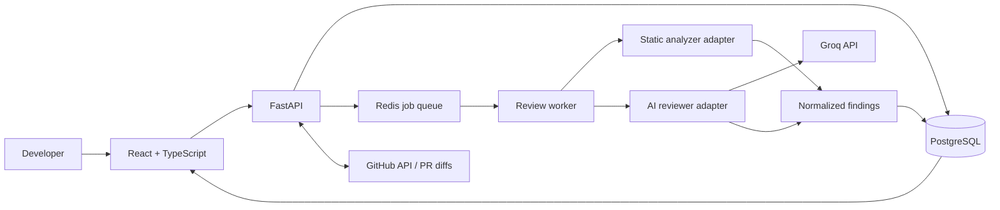

# CodeGuard AI

<p align="center">
  <strong>Catch bugs early. Review smarter. Ship with confidence.</strong>
  <br />
  An AI-assisted code review platform that combines deterministic static analysis with explainable AI findings.
</p>

---

> **Project status: Early build / roadmap stage.** This repository is being built in public. Features below are marked as planned until implemented and tested. The demo experience will distinguish sample data from real analysis.

## Why CodeGuard AI?

Code reviews should do more than point out suspicious lines. They should explain **why a change matters**, show evidence, suggest a safer alternative, and help developers decide what to fix first.

CodeGuard AI is designed to bring those signals into one focused workflow:

- **Findings with context** — severity, affected file and line, evidence, impact, and a suggested fix.
- **Two complementary reviewers** — deterministic rules for repeatable checks, plus an LLM for contextual explanations and additional hypotheses.
- **A review you can trust** — findings retain their source; AI suggestions are advisory, not presented as proven vulnerabilities.
- **A useful first run** — a clearly labelled demo review lets people explore the experience without API credentials.
- **A developer CLI** — scan local folders, print readable findings or JSON, and use documented exit codes in scripts and CI; local scans do not upload code by default.
- **Built for real engineering** — typed API contracts, async review jobs, tests, observability, and least-privilege GitHub integration.

## Product experience

The target workflow:

1. **Choose a source** — explore a sample review, scan a local folder with the CLI, submit a bounded diff, or connect a GitHub pull request.
2. **Run analysis** — combine static-analysis results with a structured AI review.
3. **Prioritize** — group findings by severity and category, with file/line context and supporting evidence.
4. **Understand** — inspect why a finding matters and review a proposed fix.
5. **Decide** — accept, dismiss, or revisit findings; fixes are never applied automatically.

## Signature features

| Feature | What makes it useful | Status |
|---|---|---|
| Review dashboard | Severity overview, recent reviews, and a guided first-run experience | Planned |
| Developer CLI | Scan a local directory, print text/JSON results, and fail on a configurable severity threshold for scripts/CI | Planned |
| Inline findings | Navigate from a finding to its file and line context | Planned |
| Static + AI analysis | Pair repeatable rules with contextual explanation | Planned |
| Confidence-aware triage | Rank findings carefully without pretending model confidence is calibrated probability | Planned |
| GitHub PR workflow | Review bounded PR diffs with least-privilege access | Planned |
| Security-first processing | Treat repository content as untrusted input; never execute suggested fixes | Planned |

## Architecture direction

Start as a **modular monolith**, not a fleet of microservices. Keep one deployable API and a separately runnable worker for long-running reviews. Application interfaces isolate provider-specific details, so the model or analyzer can be changed without rewriting business logic.



### Planned technology stack

- **Frontend:** React, TypeScript, Vite, accessible component patterns.
- **API:** Python, FastAPI, Pydantic.
- **Persistence:** PostgreSQL, SQLAlchemy, Alembic.
- **Background processing:** Redis-backed queue and an independently runnable worker.
- **Analysis:** CLI entry point and Semgrep adapter plus a provider-neutral AI reviewer interface.
- **LLM provider:** Groq API, configured server-side via environment variables.
- **Quality:** automated unit/integration tests, linting, type checks, Docker Compose, and GitHub Actions.

Exact dependency and model choices will be documented and pinned as implementation begins.

## Engineering principles

1. **Evidence before confidence.** Keep the analyzer, rule ID, file/line range, and evidence attached to every finding.
2. **AI is advisory.** A model-generated suspicion is not automatically a confirmed vulnerability.
3. **Treat repository content as untrusted.** Source files and comments must not override review policy or reveal secrets.
4. **Never execute suggested fixes.** Show them as proposals for a developer to inspect.
5. **Protect credentials and code.** Keep provider tokens on the backend, redact secrets in logs, bound request sizes and timeouts, and explain what content is sent to external providers.
6. **Design for testability.** Put provider SDKs behind interfaces and test business logic without network credentials.
7. **Be honest about status.** Screenshots and seeded findings must be labelled as demo data; roadmap items are not advertised as shipped features.

## Repository layout target

```text
CodeGuardAI/
├── frontend/                 # React + TypeScript application
├── backend/
│   ├── app/
│   │   ├── api/v1/           # Thin HTTP routes
│   │   ├── domain/            # Entities and business invariants
│   │   ├── application/       # Use cases and provider interfaces
│   │   ├── infrastructure/    # Database, GitHub, analyzer, AI, queue adapters
│   │   └── core/              # Configuration, logging, security
│   ├── tests/
│   └── alembic/
├── docs/                      # Architecture, threat model, decisions
├── .env.example
├── docker-compose.yml
└── README.md
```

This is the **target layout**, not a claim that every directory exists today.

## Getting started

The project bootstrap is in progress. Until the runnable application is added, use the GitHub issue backlog to follow implementation work:

- [Open issues and roadmap](https://github.com/nischalk987/CodeGuardAI/issues)
- [Repository](https://github.com/nischalk987/CodeGuardAI)

When setup is available, this section will include a tested fresh-clone workflow and demo command. Do not commit real API keys. A future `.env.example` should contain variable names and placeholders only.

## Quality bar for the MVP

- A first-time user can explore a labelled demo without secrets.
- The same input produces stable deterministic static-analysis findings.
- Review jobs have explicit states, bounded retries, and useful errors.
- Findings are typed, traceable to evidence and source, and navigable by file/line.
- Provider errors, malformed model output, prompt-injection fixtures, and secret redaction are tested.
- A fresh clone can run via documented steps; CI validates lint, tests, and builds.
- The demo never claims a real repository was analyzed when it uses seeded data.

## Roadmap

The initial implementation backlog is tracked as GitHub issues. The intended order is:

1. **Visible value first:** dashboard and demo review experience.
2. **Reliable foundation:** FastAPI health/config, domain models, and tests.
3. **Core analysis:** CLI, Groq adapter, and deterministic static analysis.
4. **End-to-end flow:** persisted review API and asynchronous worker.
5. **Signature integration:** GitHub PR import and inline review experience.
6. **Production-minded polish:** security regression tests, CI, reproducible setup, and documentation.

## Responsible-use note

CodeGuard AI is a developer-assistance tool, not a guarantee of correctness or security. Human review remains necessary. Before sending private source code to any hosted AI provider, users should evaluate that provider's current terms, retention policies, and organizational requirements.

---

**Catch bugs early. Review smarter. Ship better code.**
