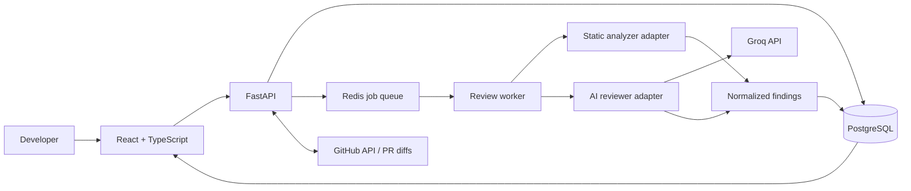

# CodeGuard AI

<p align="center">
  <strong>Catch bugs early. Review smarter. Ship with confidence.</strong>
  <br />
  An AI-assisted code review platform that combines deterministic static analysis with explainable AI findings.
</p>

---

> **Project status: Early MVP in progress.** The React dashboard and FastAPI sample endpoints are implemented, along with backend configuration, structured logging, CORS, consistent JSON errors, and health checks. Local deterministic scanning, an optional Semgrep CLI analyzer, and a PostgreSQL-backed review API are implemented. Groq review is available through an explicit single-file CLI opt-in; dashboard submission and GitHub PR review remain in progress.

## Why CodeGuard AI?

Code reviews should do more than point out suspicious lines. They should explain **why a change matters**, show evidence, suggest a safer alternative, and help developers decide what to fix first.

CodeGuard AI is designed to bring those signals into one focused workflow:

- **Findings with context** — severity, affected file and line, evidence, impact, and a suggested fix.
- **Two complementary reviewers** — deterministic rules for repeatable checks, plus an LLM for contextual explanations and additional hypotheses.
- **A review you can trust** — findings retain their source; AI suggestions are advisory, not presented as proven vulnerabilities.
- **A useful first run** — a clearly labelled demo review lets people explore the experience without API credentials.
- **A developer CLI** — scan local folders, print readable findings or JSON, and use documented exit codes in scripts and CI; local scans do not upload code by default.
- **Built for real engineering** — typed API contracts, async review jobs, tests, observability, and least-privilege GitHub integration.

## Product experience

The target workflow:

1. **Choose a source** — explore a sample review, scan a local folder with the CLI, submit a bounded diff, or connect a GitHub pull request.
2. **Run analysis** — combine static-analysis results with a structured AI review.
3. **Prioritize** — group findings by severity and category, with file/line context and supporting evidence.
4. **Understand** — inspect why a finding matters and review a proposed fix.
5. **Decide** — accept, dismiss, or revisit findings; fixes are never applied automatically.

## Signature features

| Feature | What makes it useful | Status |
|---|---|---|
| Review dashboard | Severity summary, searchable/filterable sample findings, and local finding triage | Implemented (demo data only) |
| Developer CLI | Scan a local directory with deterministic checks, optional Semgrep, text/JSON output, and a configurable severity threshold | Implemented (remote AI is single-file and explicit opt-in) |
| Inline findings | Navigate from a finding to its file and line context | Planned |
| Static + AI analysis | Pair repeatable rules with contextual explanation | Implemented in the CLI (remote AI requires explicit opt-in) |
| Confidence-aware triage | Rank findings carefully without pretending model confidence is calibrated probability | Planned |
| GitHub PR workflow | Review bounded PR diffs with least-privilege access | Planned |
| Security-first processing | Treat repository content as untrusted input; never execute suggested fixes | Planned |

## Architecture direction

Start as a **modular monolith**, not a fleet of microservices. Keep one deployable API and a separately runnable worker for long-running reviews. Application interfaces isolate provider-specific details, so the model or analyzer can be changed without rewriting business logic.



### Planned technology stack

- **Frontend:** React, TypeScript, Vite, accessible component patterns.
- **API:** Python, FastAPI, Pydantic.
- **Persistence:** PostgreSQL, SQLAlchemy, Alembic.
- **Background processing:** Redis-backed queue and an independently runnable worker.
- **Analysis:** CLI entry point and Semgrep adapter plus a provider-neutral AI reviewer interface.
- **LLM provider:** Groq API, configured server-side via environment variables.
- **Quality:** automated unit/integration tests, linting, type checks, Docker Compose, and GitHub Actions.

Exact dependency and model choices will be documented and pinned as implementation begins.

## Engineering principles

1. **Evidence before confidence.** Keep the analyzer, rule ID, file/line range, and evidence attached to every finding.
2. **AI is advisory.** A model-generated suspicion is not automatically a confirmed vulnerability.
3. **Treat repository content as untrusted.** Source files and comments must not override review policy or reveal secrets.
4. **Never execute suggested fixes.** Show them as proposals for a developer to inspect.
5. **Protect credentials and code.** Keep provider tokens on the backend, redact secrets in logs, bound request sizes and timeouts, and explain what content is sent to external providers.
6. **Design for testability.** Put provider SDKs behind interfaces and test business logic without network credentials.
7. **Be honest about status.** Screenshots and seeded findings must be labelled as demo data; roadmap items are not advertised as shipped features.

## Repository structure

```text
CodeGuardAI/
├── frontend/                 # React + TypeScript application
├── backend/
│   ├── app/
│   │   ├── analysis/          # Built-in and optional Semgrep analyzers
│   │   ├── api/v1/reviews.py  # Sample review endpoints
│   │   ├── cli.py             # `codeguard scan` command
│   │   ├── domain/            # Framework-independent review/finding model
│   │   ├── main.py            # FastAPI app, health check, middleware
│   │   ├── schemas.py         # Typed API response models
│   │   └── ...                # Configuration and logging modules
│   ├── tests/                 # API, domain, analyzer, and CLI tests
│   └── pyproject.toml
├── .github/                   # Issue and PR templates
├── .env.example
├── CONTRIBUTING.md
├── SECURITY.md
└── README.md
```

This shows the current implementation. Background workers remain future work.

## Getting started

Run the frontend and backend in separate terminals.

**1. Start the backend** (Python 3.11+):

```bash
cd backend
python -m venv .venv
# Windows PowerShell:
.\.venv\Scripts\Activate.ps1
# macOS/Linux:
# source .venv/bin/activate
python -m pip install -e ".[dev]"
# Set DATABASE_URL privately in backend/.env to enable persisted review routes.
uvicorn app.main:app --reload --host 127.0.0.1 --port 8000
```

The API docs are available at [http://127.0.0.1:8000/docs](http://127.0.0.1:8000/docs). The labelled sample endpoint is `GET /api/v1/reviews/demo`. Configure `DATABASE_URL` privately in `backend/.env`, verify the target database, and run `alembic upgrade head` from `backend/` to enable persistent review routes. Review creation scans a bounded snippet with local deterministic checks; it does not call AI or execute submitted code.

**2. Start the frontend** (Node.js 20+):

```bash
cd frontend
npm install
npm run dev
```

Open the Vite URL shown in the terminal, usually [http://127.0.0.1:5173](http://127.0.0.1:5173). The UI attempts to load the backend's sample review and falls back to local sample data when the API is unavailable.

Run frontend checks from `frontend/` with `npm test` and `npm run build`. The dashboard displays seeded illustrative findings and does not analyze source code. The backend API and CLI run local deterministic checks and can optionally invoke Semgrep. AI review requires the explicit `--ai-review` flag for a single file and discloses that the file will be sent to Groq. Full usage and exit codes are documented in [backend/README.md](backend/README.md#local-cli-scanning).

### Dashboard preview

<!-- Add a screenshot of the responsive dashboard here. Keep the image labelled as sample data. -->

**3. Run backend tests** in the backend virtual environment:

```bash
pytest
```

For development tasks and acceptance criteria, see the [GitHub issue backlog](https://github.com/nischalk987/CodeGuardAI/issues). The backend foundation includes environment-validated settings, configurable CORS, structured/redacted logging, consistent JSON error responses, and health/configuration tests. Do not commit real API keys; keep secrets in backend environment variables and out of frontend code.

## Quality bar for the MVP

- A first-time user can explore a labelled demo without secrets.
- The same input produces stable deterministic static-analysis findings.
- Review jobs have explicit states, bounded retries, and useful errors.
- Findings are typed, traceable to evidence and source, and navigable by file/line.
- Provider errors, malformed model output, prompt-injection fixtures, and secret redaction are tested.
- A fresh clone can run via documented steps; CI validates lint, tests, and builds.
- The demo never claims a real repository was analyzed when it uses seeded data.

## Roadmap

The initial implementation backlog is tracked as GitHub issues. The intended order is:

1. **Dashboard foundation:** interactive dashboard and clearly labelled demo review (implemented).
2. **Reliable backend:** configuration, health checks, structured logging, CORS, and API errors (implemented).
3. **Domain and analysis:** validated Review/Finding models, Groq adapter, and deterministic CLI/static analysis (in progress; Issues #3–5).
4. **End-to-end flow:** persisted review API and asynchronous worker (Issues #6–7).
5. **GitHub integration:** least-privilege PR import and inline review experience (Issues #8–9).
6. **Release readiness:** CI/security checks, reproducible setup, adversarial tests, and portfolio documentation (Issues #10–12).
7. **Deployment:** publish and verify the frontend/backend after core functionality and checks are complete (Issue #15).

## Responsible-use note

CodeGuard AI is a developer-assistance tool, not a guarantee of correctness or security. Human review remains necessary. Before sending private source code to any hosted AI provider, users should evaluate that provider's current terms, retention policies, and organizational requirements.

---

**Catch bugs early. Review smarter. Ship better code.**
