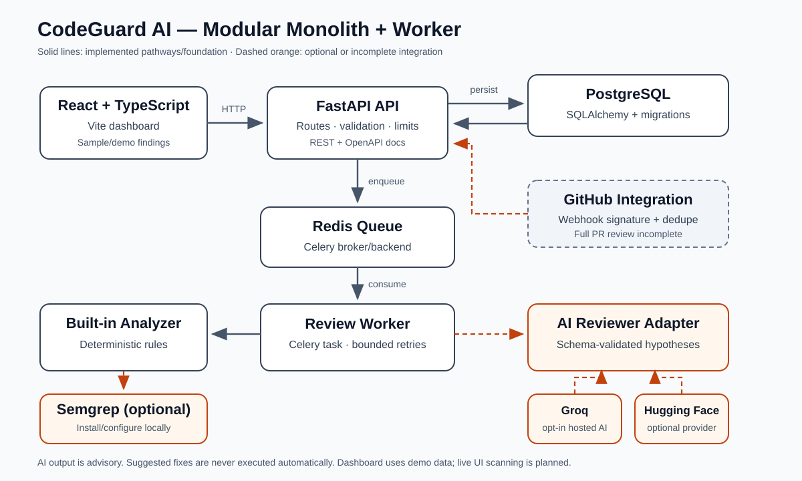

# CodeGuard AI

<p align="center">
  <strong>Catch bugs early. Review smarter. Ship with confidence.</strong><br />
  An engineering-focused code-review MVP combining deterministic checks with optional, advisory AI analysis.
</p>

<p align="center">
  <a href="https://github.com/nischalk987/CodeGuardAI/actions"></a>
  <a href="https://github.com/nischalk987/CodeGuardAI/actions"></a>
</p>

> **Status: early MVP.** This repository contains a working dashboard demo, FastAPI endpoints, local deterministic scanning, a CLI, optional Semgrep integration, an opt-in single-file AI reviewer, a PostgreSQL-backed review API, and queue/worker code. The dashboard's findings are illustrative demo data; the dashboard does not currently analyze source code end-to-end. The GitHub App webhook intake exists, but full pull-request diff retrieval/review and inline annotations are not complete product workflows.

## The problem

Small teams and individual developers need help spotting risky changes without treating an AI model as an oracle. CodeGuard AI is aimed at developers, student project teams, and engineering reviewers who want repeatable static checks, evidence-linked findings, and optional model-generated hypotheses in one understandable workflow.

The goal is not to replace human review or promise perfect vulnerability detection. It is to surface review leads with enough context for a developer to verify.

## What works today?

| Capability | Status | Notes |
|---|---|---|
| React + TypeScript dashboard | **Implemented** | Search/filter sample findings, severity summaries, detail view, local triage; content is demo data |
| FastAPI API and health endpoint | **Implemented** | OpenAPI docs and consistent error responses |
| Local deterministic CLI scan | **Implemented** | Built-in rules; can scan local files/directories |
| Optional Semgrep adapter | **Implemented** | Requires Semgrep to be installed/configured locally |
| AI review via Groq or Hugging Face | **Implemented with constraints** | Explicit CLI opt-in for one file; credentials are backend-only; results are advisory |
| PostgreSQL review persistence | **Implemented** | Configure a valid `DATABASE_URL` and apply migrations |
| Redis/Celery queue and workers | **Implemented foundation** | Local review API and GitHub webhook enqueue tasks; services must be configured and running |
| GitHub webhook signature and deduplication | **Implemented foundation** | Authenticates supported PR events and queues review identity |
| End-to-end PR diff fetch, complete analysis, and inline comments | **Planned / incomplete** | Do not treat webhook intake as a finished PR-review integration |
| Dashboard submits real code for scanning | **Planned / incomplete** | Current dashboard preview uses demo findings |
| Automatically apply AI fixes | **Not supported by design** | Suggested fixes are proposals for human review |

## Try the demo

### Option A — one command with Docker Compose

Requirements: Docker Desktop or Docker Engine with the Compose plugin.

```bash
git clone https://github.com/nischalk987/CodeGuardAI.git
cd CodeGuardAI
docker compose up --build
```

Open:

- Dashboard: [http://localhost:5173](http://localhost:5173)
- API health: [http://localhost:8000/health](http://localhost:8000/health)
- Interactive OpenAPI docs: [http://localhost:8000/docs](http://localhost:8000/docs)
- Labelled demo review: [http://localhost:8000/api/v1/reviews/demo](http://localhost:8000/api/v1/reviews/demo)

The Compose stack supplies local-only PostgreSQL credentials and waits for service health checks. Do not reuse the sample database password outside local development. No Groq, Hugging Face, or GitHub secret is required just to open the dashboard or explore the labelled demo. Stop with `docker compose down`. Use `docker compose down -v` only when you intend to delete the local PostgreSQL volume.

If the demo endpoint is unavailable, view the frontend's local fallback sample data; the UI is explicitly not a live scan.

### Option B — run frontend/backend manually

Backend (Python 3.11+):

```bash
cd backend
python -m venv .venv
# Windows PowerShell: .\.venv\Scripts\Activate.ps1
# macOS/Linux: source .venv/bin/activate
python -m pip install -e ".[dev]"
uvicorn app.main:app --reload --host 127.0.0.1 --port 8000
```

Frontend (Node.js 20+), in a second terminal:

```bash
cd frontend
npm install
npm run dev
```

The dashboard can fall back to local demo data if the API is not running. Persistence and queue-backed routes require database/Redis configuration and the worker process; they are not required to see the dashboard demo.

## Run a real local static scan

The CLI scans files/directories with deterministic checks; it does not upload source by default.

```bash
cd backend
python -m pip install -e ".[dev]"
python -m codeguard scan tests/fixtures/safe_sample.py
python -m codeguard scan tests/fixtures/static_sample.py --format json
```

Use `python -m codeguard scan --help` for analyzer, ignore-path, output-format, and severity-threshold options. Semgrep needs to be installed separately when choosing that analyzer.

AI review is a separate, explicit opt-in and supports one source file at a time. Configure either `GROQ_API_KEY` or `HF_TOKEN` privately in the backend environment, select the provider, and run:

```bash
python -m codeguard scan tests/fixtures/static_sample.py --ai-review
```

This command sends that selected file to the configured hosted provider. Do not use private or proprietary source unless your organization approves the provider, terms, and data handling.

## Architecture



The system is organized as a modular monolith: one FastAPI API with explicit domain/application/adapter boundaries, plus a separately runnable queue worker for longer jobs. This is simpler to develop and test than splitting an early MVP into multiple networked microservices. Provider-specific APIs sit behind adapters; the deterministic analyzer remains useful when model credentials or network access are unavailable.

Key paths:

- `frontend/`: React, TypeScript, Vite dashboard.
- `backend/app/api/v1/`: FastAPI review and GitHub webhook routes.
- `backend/app/application/` and `backend/app/domain/`: application use cases and framework-independent entities.
- `backend/app/analysis/`: built-in deterministic and optional Semgrep analyzers.
- `backend/app/infrastructure/ai/`: Groq, Hugging Face, and structured-review adapters.
- `backend/app/jobs/`: Celery queue and worker code.
- `backend/app/infrastructure/persistence/`: SQLAlchemy persistence and migrations.
- `backend/tests/`: API, CLI, domain, analyzer, provider, logging, queue, and adversarial tests.

## Design decisions and trade-offs

**Deterministic analysis + AI.** Deterministic rules are repeatable, inexpensive, and work offline. AI can provide contextual hypotheses, but can hallucinate and is sensitive to prompt injection. Model output is parsed against a strict schema and checked against the selected file, line ranges, and evidence; AI findings remain hypotheses.

**Asynchronous jobs.** The API can enqueue longer-running reviews instead of holding a request open for the full scan. This introduces operational requirements: PostgreSQL, Redis, worker lifecycle, idempotency, and retry handling must be configured correctly.

**Security and privacy.** Source code is untrusted input. Prompt instructions are not a sandbox. Request/input sizes, provider timeouts, retries and concurrency are bounded; logs redact common secret patterns. Hosted AI review is opt-in and sends the selected file to the configured provider. Regex redaction is best-effort, not a guarantee against every secret format.

**Least privilege GitHub integration.** Webhook signatures are verified and event identity is deduplicated. Full end-to-end PR diff analysis and inline annotations remain incomplete, so this should be described as integration groundwork rather than a finished automated reviewer.

**Why not microservices?** The modules and interfaces are separated to make later extraction possible, but a single application codebase reduces deployment complexity and keeps tests fast for this stage.

## Representative tests and sample findings

CI includes backend lint/tests, frontend typecheck/build/tests, Compose configuration validation, dependency audits, secret scanning, and a dedicated adversarial regression suite. The latest result is available on the [GitHub Actions page](https://github.com/nischalk987/CodeGuardAI/actions).

Representative tests include:

- `backend/tests/test_ai_reviewer.py`: structured output, path/evidence validation, malformed output, bounded retries and safe provider errors.
- `backend/tests/test_analysis.py`: deterministic analyzer behavior.
- `backend/tests/test_review_api.py`: persisted review API behavior.
- `backend/tests/test_github_webhook.py`: webhook signatures and delivery handling.
- `backend/tests/test_adversarial_security.py`: prompt-injection fixtures, secret redaction, malformed model output, size/time/retry/concurrency bounds, and proof that suggested fixes are not executed.
- `frontend/src/review.test.ts`: dashboard data behavior.

The dashboard demo endpoint returns **illustrative seeded findings**, not results from scanning a real repository. Example demo finding: a token-like value may be exposed in logs; the suggested mitigation is to log an opaque request/session identifier instead of the credential. Treat this as an example for exploring the interface, not a claim about your codebase.

## 2–3 minute demo walkthrough

1. **0:00–0:20 — Problem and status.** “CodeGuard AI combines repeatable static checks with optional advisory AI findings. This is an early MVP; the dashboard preview is labelled demo data.”
2. **0:20–0:50 — Dashboard.** Open [localhost:5173](http://localhost:5173). Show severity counts, search/category filters, a finding's file/line context, and local triage. Clarify that previewing does not initiate a scan.
3. **0:50–1:20 — API.** Open [localhost:8000/docs](http://localhost:8000/docs), show `/health`, then `GET /api/v1/reviews/demo`. Point out the sample is explicitly illustrative.
4. **1:20–1:55 — CLI.** Scan `backend/tests/fixtures/static_sample.py` with `python -m codeguard scan ... --format json`. Explain that deterministic analysis runs locally and does not upload code by default.
5. **1:55–2:25 — Engineering quality.** Show GitHub Actions checks and tests for malicious prompt text, provider errors, input bounds and untrusted suggested fixes.
6. **2:25–2:50 — Trade-offs and roadmap.** Explain deterministic versus AI findings, hosted-provider privacy considerations, and that full PR-diff review/inline comments and live dashboard scanning are unfinished.

## Environment variable reference

Keep real values in untracked environment files or a secret manager. Do not put credentials in frontend variables.

| Variable | Purpose | Required? |
|---|---|---|
| `ENVIRONMENT`, `LOG_LEVEL` | Runtime environment and logging level | Defaults available |
| `FRONTEND_ORIGIN`, `CORS_ORIGINS` | Browser origins accepted by API | Defaults for development |
| `DATABASE_URL` | PostgreSQL persistence | Only for persistence-backed endpoints/workers |
| `REDIS_URL` | Celery broker/backend | Required for queue-backed operations |
| `AI_PROVIDER` | `groq` or `huggingface` | Defaults to Groq; AI opt-in only |
| `GROQ_API_KEY`, `GROQ_MODEL` | Groq credentials and model ID | Key required for Groq AI review |
| `GROQ_TIMEOUT_SECONDS`, `GROQ_MAX_RETRIES` | Groq request limits | Defaults available |
| `HF_TOKEN`, `HF_MODEL` | Hugging Face Inference Providers | Token required when selected |
| `HF_TIMEOUT_SECONDS`, `HF_MAX_RETRIES` | Hugging Face request limits | Defaults available |
| `AI_REVIEW_MAX_INPUT_BYTES`, `AI_REVIEW_MAX_CONCURRENCY` | AI input and in-flight call bounds | Defaults available |
| `GITHUB_APP_ID`, `GITHUB_PRIVATE_KEY_PATH`, `GITHUB_WEBHOOK_SECRET` | GitHub App webhook/integration settings | Optional; integration is incomplete |
| `GITHUB_API_BASE_URL`, `GITHUB_MAX_DIFF_BYTES`, `GITHUB_MAX_FILES` | GitHub API endpoint and intake bounds | Defaults available |

Canonical placeholder configuration: [`.env.example`](.env.example) and [`backend/.env.example`](backend/.env.example).

## Roadmap

- Complete dashboard-to-API source submission and show live scan status/results.
- Finish GitHub PR diff retrieval, bounded analysis orchestration, and review summary delivery.
- Add verified end-to-end integration tests and a safe disposable deployment.
- Improve language/rule coverage, calibrate confidence carefully, and add richer diff-context handling.
- Capture and maintain a current screenshot of the real dashboard demo.

## Known limitations

- Dashboard findings are seeded/demo data; it is not an end-to-end live scanning interface yet.
- AI review is explicit opt-in and single-file; provider output is advisory and can be wrong.
- Prompt injection cannot be eliminated by prompt wording alone.
- Secret-pattern redaction can miss unrecognized credentials.
- Semgrep requires a separate local installation.
- Database/queue-backed features need correctly configured PostgreSQL, Redis and worker processes.
- GitHub webhook intake is present but complete PR review and inline annotations remain unfinished.
- No suggested fix is applied automatically.

## Responsible use

Use CodeGuard AI as a review aid, not as a security certification or substitute for human review. Verify findings and suggested fixes independently. Before sending private source code to a hosted model, review its current terms, retention policies and your organization's requirements. Never submit secrets intentionally, and rotate credentials if exposure is suspected.

## Contributor workflow

See [CONTRIBUTING.md](CONTRIBUTING.md) for branch, tests, pull request, and review expectations. Security reporting guidance is in [SECURITY.md](SECURITY.md).

---

**Catch bugs early. Review smarter. Ship better code.**
